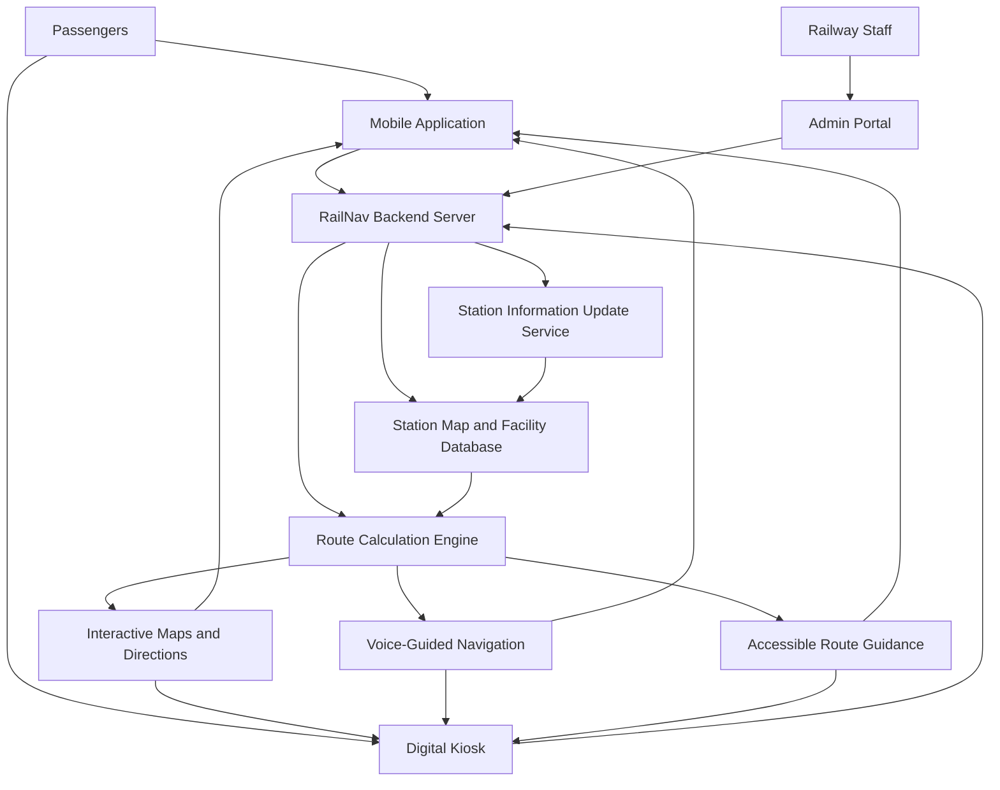

# Smart India Hackathon Workshop
# Date: 23-10-2026
## Register Number: 212225230009
## Name: AKASHINI V
## Problem Title
SIH 1710: Enhancing Navigation for Railway Station Facilities and Locations
## Problem Description
Background: Railway stations are complex environments with numerous facilities and locations such as ticket counters, platforms, restrooms, food courts, and waiting areas. Passengers often face difficulties in navigating these spaces, especially in large or unfamiliar stations. Efficient and user-friendly navigation systems are crucial for improving passenger experience, reducing congestion, and ensuring timely travel connections. Description: The problem involves developing a comprehensive navigation solution for railway stations that assists passengers in locating various facilities and destinations within the station premises. This includes creating detailed maps, providing real-time directions, and integrating features such as accessibility options for individuals with disabilities. The solution should be intuitive, easy to use, and accessible via multiple platforms, including mobile devices and digital kiosks. Key challenges include updating navigation information in real-time, ensuring accuracy, and accommodating the diverse needs of all passengers. Expected Solution: The expected solution is a multi-platform navigation system that provides detailed, real-time directions to all facilities and locations within a railway station. This system should include: A mobile application with 3D interactive maps and step-by-step navigation. Digital kiosks located throughout the station with touch-screen interfaces. Voice-guided navigation for visually impaired passengers. Regular updates to reflect changes in station layout and facility locations. Integration with existing railway apps and services for seamless user experience. The solution should enhance the overall passenger experience by reducing confusion, saving time, and improving accessibility within the station.

## Problem Creater's Organization
Ministry of Railway

## Idea

RailNav – Smart Railway Station Navigation System

RailNav is a smart navigation system designed to help passengers easily find platforms, ticket counters, restrooms, food courts, waiting halls, and other facilities inside railway stations. It provides interactive station maps, step-by-step directions, QR code-based location identification, and voice-guided navigation for visually impaired passengers. The system also helps passengers with disabilities identify accessible routes, lifts, and ramps. Through a mobile application and digital kiosks, RailNav aims to reduce confusion, save time, and make railway stations more accessible and passenger-friendly.

## Proposed Solution / Architecture Diagram

### Proposed Solution

RailNav is a multi-platform railway station navigation system that helps passengers locate facilities and navigate inside railway stations. Passengers can use a mobile application or digital kiosk to select their destination and receive step-by-step directions through an interactive station map.

The system uses digital station maps, a facility database, and a route calculation algorithm to identify suitable paths. QR codes or indoor positioning technologies can help identify the passenger's starting location. Voice-guided instructions support visually impaired passengers, while accessible routing helps passengers find lifts, ramps, and wheelchair-friendly paths. Railway staff can update station maps and facility information through an administrative portal.

### Architecture Diagram

### Working Process

1. The passenger opens the RailNav mobile application or uses a digital kiosk.
2. The passenger selects a destination, such as a platform, restroom, or ticket counter.
3. The system identifies the starting location using a QR code or supported indoor positioning technology.
4. The route calculation engine determines a suitable path using Dijkstra's or A* algorithm.
5. The system displays the route and provides step-by-step directions.
6. Voice guidance and accessible route options are provided according to passenger needs.
7. Railway staff update station maps, facility locations, and route information through the admin portal.

## Use Cases

1. **Search Station Facilities:** Passengers can search for platforms, ticket counters, restrooms, food courts, waiting halls, and drinking water facilities.

2. **Indoor Navigation:** Passengers can select a destination and receive step-by-step directions through an interactive station map.

3. **QR Code-Based Location Identification:** Passengers can scan QR codes placed around the station to identify their starting location.

4. **Voice-Guided Navigation:** Visually impaired passengers can receive audio instructions to navigate the station more easily.

5. **Accessible Route Finding:** Passengers with disabilities can locate wheelchair-accessible routes, ramps, lifts, and suitable facilities.

6. **Digital Kiosk Navigation:** Passengers can use touchscreen kiosks to search for facilities and obtain directions without installing the mobile application.

7. **Station Information Updates:** Railway staff can update station maps, facility locations, and information about temporarily unavailable routes or facilities.

8. **Route Calculation:** The system calculates suitable routes to help passengers reach their destinations efficiently.

9. **Multilingual Navigation:** Passengers can receive directions in supported languages.

10. **Facility Management:** Administrators can manage station information and maintain accurate navigation data.

### Primary Actors

- **Passenger:** Searches for facilities and receives navigation directions.
- **Visually Impaired Passenger:** Uses voice-guided navigation.
- **Passenger with Disabilities:** Finds accessible routes and facilities.
- **Railway Staff:** Updates station maps and facility information.
- **Administrator:** Manages station data and system information.

## Technology Stack

The following technologies are proposed for developing the RailNav Smart Railway Station Navigation System.

| Component | Technology | Purpose |
|---|---|---|
| Frontend | Flutter | Develop a cross-platform mobile application |
| Backend | Python with FastAPI | Handle navigation requests and application logic |
| Database | PostgreSQL | Store station maps, facility details, and location information |
| Digital Maps | OpenStreetMap | Provide map data for station navigation |
| Map Visualization | Leaflet / Flutter Map | Display interactive maps |
| Route Calculation | Dijkstra's Algorithm / A* Algorithm | Calculate suitable routes to destinations |
| Voice Guidance | Text-to-Speech (TTS) | Provide audio navigation instructions |
| Indoor Positioning | QR Codes / Bluetooth Beacons | Identify passenger locations inside stations |
| Admin Portal | HTML, CSS, JavaScript | Manage station maps and facility information |
| Cloud Hosting | AWS (optional) | Host backend services and application data |
| Version Control | Git and GitHub | Manage source code and support collaboration |

### Technology Selection

- **Flutter:** Builds a mobile application for Android and iOS.
- **FastAPI:** Connects the mobile application and kiosks to backend services.
- **PostgreSQL:** Stores station facilities, navigation points, and route information.
- **OpenStreetMap:** Provides map data that can be supplemented with detailed indoor station maps.
- **Dijkstra's or A* Algorithm:** Calculates suitable routes using station pathways and destination locations.
- **QR Codes:** Help passengers identify their starting location without depending entirely on GPS.
- **Text-to-Speech:** Converts navigation instructions into audio guidance.
- **Git and GitHub:** Support source code management and team collaboration.

*Note: These are proposed technologies. Final selections may depend on project requirements, available station data, infrastructure, and implementation needs.*

## Dependencies

### Software Dependencies
- Flutter SDK – Mobile application development
- Python 3 – Backend development
- FastAPI – Backend API services
- PostgreSQL – Database management
- OpenStreetMap – Map data
- Leaflet / Flutter Map – Interactive map visualization
- Text-to-Speech (TTS) – Voice-guided navigation
- Git and GitHub – Version control

### Infrastructure Dependencies
- Accurate railway station maps and facility information
- QR codes for identifying passenger locations
- Internet connectivity for cloud services and updates
- Mobile devices and touchscreen kiosks
- Railway authority permission and station data
- Cloud hosting (optional)
- Bluetooth beacons for indoor positioning (optional)

### External Dependencies
- Authorized railway integration APIs, where available
- Map services and applicable usage requirements
- Multilingual voice support (optional)
- Updated information about facility locations and route availability

